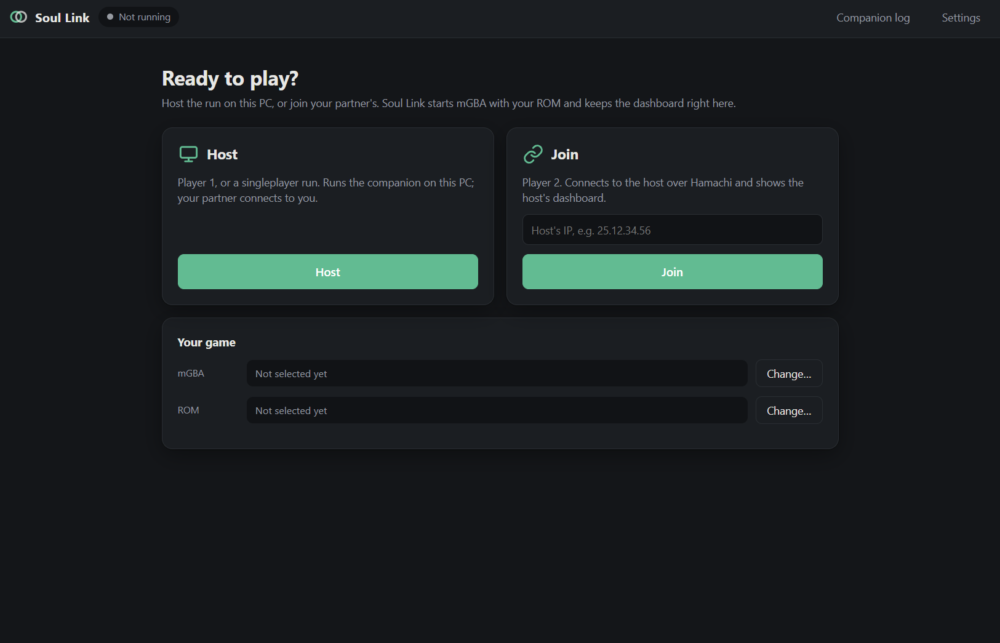
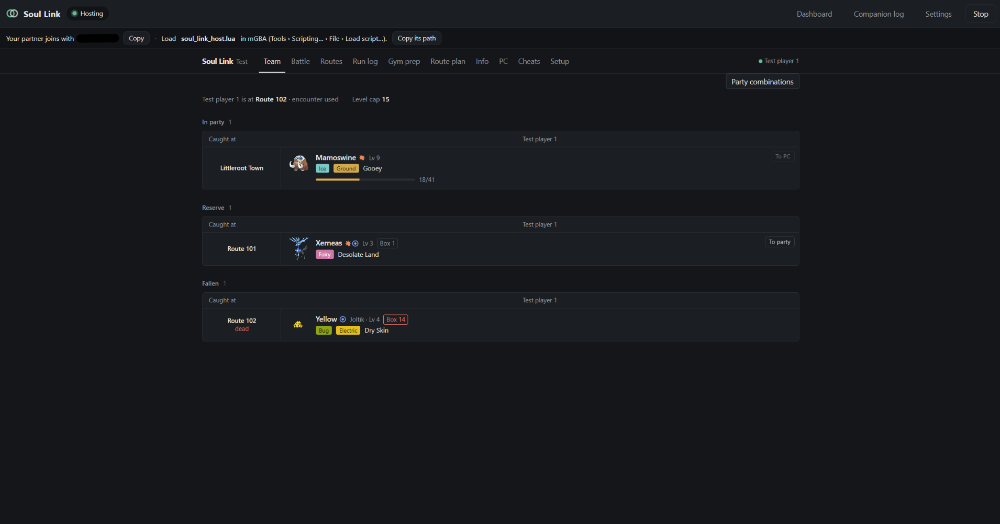
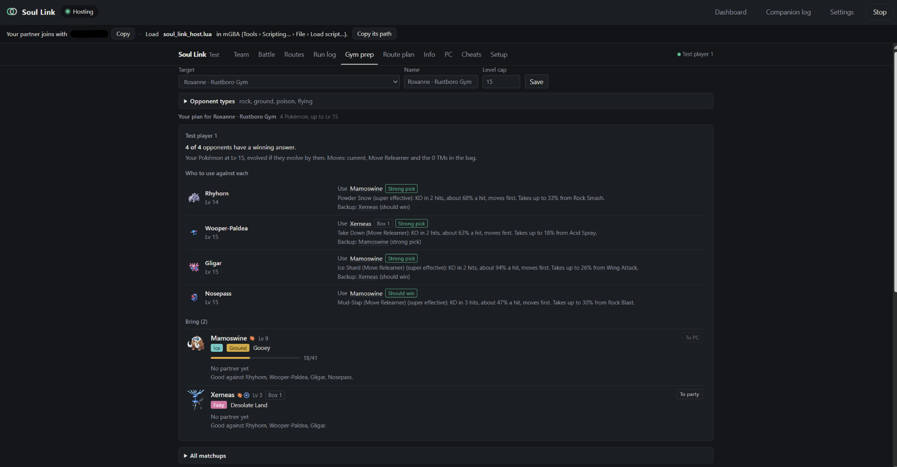
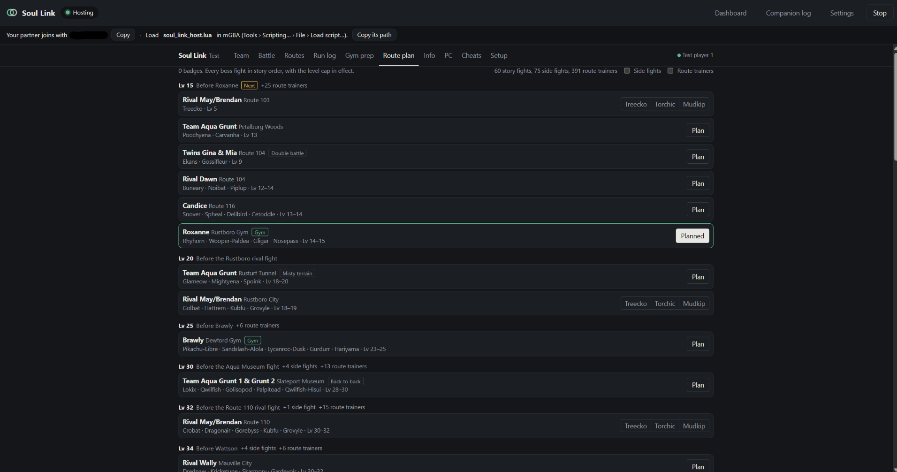
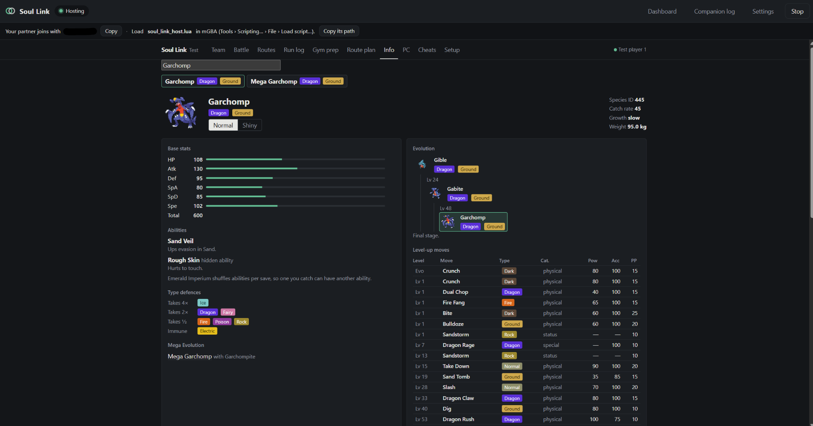

<h1 align="center">Soul Link Companion</h1>

  <b>A Soul Link Nuzlocke tracker and battle helper for mGBA</b> 
  Emerald Imperium and The Nuzlomizer, for two players or one.

  
  
  
  

  <a href="https://github.com/Hagestol/Pokemon-soul-link-companion/releases/latest">Download</a>
  ·
  <a href="#supported-games">Supported games</a>
  ·
  <a href="#what-you-need">What you need</a>
  ·
  <a href="#install-and-play">Install and play</a>
  ·
  <a href="#features">Features</a>
  ·
  <a href="#troubleshooting">Troubleshooting</a>

Soul Link Companion watches both players' games while they play in mGBA. Each catch is linked to the
partner's catch from the same place. When one of them faints, the script faints the other one in the
partner's game, and a party wipe on either side triggers the whiteout reset. A dashboard shows both
teams, the battle you're in with damage numbers for every move, and a plan for each gym. The whole
thing runs from one Windows program: press Host or Join, and it starts mGBA with your ROM and the
script already loaded.

It also works for a plain Nuzlocke with one player.

  

## Supported games

| Game | Version | Based on | Support |
| --- | --- | --- | --- |
| Emerald Imperium | 1.3.1 | Pokémon Emerald | Everything |
| The Nuzlomizer | The build in use as of November 2026 (32 MB) | Pokémon FireRed (BPRE) | Everything except Gym prep presets, the route plan and the Discord status |

The script tells the two games apart by the ROM's game code and species table, and the dashboard
switches its Pokédex, moves, items and place names to match. The Nuzlomizer randomizes its trainers
for each seed, so its Gym prep only has the custom encounter. Older builds of The Nuzlomizer lay out
memory differently and aren't supported.

ROMs aren't included. Use your own patched copy of the game.

## What you need

- Windows 10 or 11, 64-bit. The program's window uses Microsoft Edge WebView2, which comes with
  Windows 11 and current Windows 10. Python is included, so there's nothing else to install.
- [mGBA](https://mgba.io/downloads.html#development-downloads). Use the 0.11 development build
  (Windows 64-bit portable .7z): it can run a script at startup, so the program starts the game with
  the script already running. mGBA 0.10.x also works, but you load the script by hand each time.
- Your ROM of Emerald Imperium 1.3.1 or The Nuzlomizer.
- For two players: both PCs on the same network, or on a private network such as
  [Hamachi](https://vpn.net/) when you play from different places. Both players run the program.
- Internet the first time the companion starts, to fetch the species, move and item catalogs. They
  are cached after that.
- Optional: the Discord desktop app, for the run's status on your profile.

## Install and play

1. Download `Soul-Link-X.Y.Z.zip` from the [latest release](https://github.com/Hagestol/Pokemon-soul-link-companion/releases/latest)
   and unpack it anywhere, such as your desktop or a USB stick. Keep the folder together.
2. Run `Soul Link.exe`. The program isn't code-signed, so Windows may say "Windows protected your PC"
   the first time. Choose More info, then Run anyway.

### Host (Player 1, or a singleplayer run)

1. Press **Host**. The first time, pick your `mGBA.exe` and the ROM you want to play.
2. The program starts the companion, starts mGBA with your ROM and `soul_link_host.lua`, and shows the
   dashboard in its window.
3. Windows Firewall asks about Soul Link.exe the first time you host. Allow it on private networks so
   your partner can connect.
4. Give your partner the IP address shown in the bar at the top. When you have Hamachi, it shows your
   Hamachi address (25.x.x.x).

### Join (Player 2)

1. Press **Join**. The first time, pick your `mGBA.exe` and ROM.
2. Type the host's IP address and press Join.
3. The program starts the relay and mGBA with `soul_link_client.lua`, checks that the host answers, and
   shows the host's dashboard in its window.

### Starting a run

The host's dashboard asks whether to continue a saved run or start a new one, with a run name and both
player names. Tick Singleplayer for a one-player Nuzlocke. Then, in Setup, tick "Player 1 has Poké
Balls" and "Player 2 has Poké Balls" once each of you has them. Linked faints and whiteout resets stay
off until both are ticked, so the tutorial battle can't cost you anything.

> [!IMPORTANT]
> Keep mGBA savestate slots 8 and 9 free. Every Pokémon move and cheat first saves to slot 8, so you
> can load it to undo. Before an automatic whiteout reset the game is saved to slot 9. The companion
> never touches your save files, but back them up before you rely on the automatic faints and resets.

Using mGBA 0.10.x

Load the script yourself after the program starts mGBA: Tools > Scripting..., then File > Load
script... When a run starts, the program writes the script out and copies its full path, so you can
paste it into the file box with Ctrl+V. The bar at the top can copy it again.

Moving to the mGBA development build

Unpack the development build to a new folder, then copy `config.ini` and the `saves` and `states`
folders from your old mGBA folder into it. That keeps your controls, game saves and savestates. mGBA
looks for saves where `config.ini` says, so without it the new mGBA won't find them.

### Updates

When the program starts, it checks this repository for a newer release and asks whether to update.
Update now downloads it, closes the program, replaces its files and starts the new version. Your runs
(`saves`), settings and logs are kept. What happened is written to `logs\update.log`.

## Features

### Soul Link rules

- Pokémon are linked by where they were caught. You can merge several locations
  into one group in Setup.
- Linked faints go through once both players have been out of battle for a moment, and the script
  reads the HP back to check. Anything it can't confirm stays queued.
- A whiteout reset needs a party with no survivors, confirmed by separate scans.
- Route duplicates are marked illegal and get no partner. The type clause counts primary types across
  both parties, and the species clause warns in wild battles when either of you already has that
  evolution line.
- Box 1 is the reserve and Box 14 is the Death Box. Fallen Pokémon move to Box 14 after the battle,
  and the dashboard warns when a linked pair is split between the party and the PC.
- Each faint records its cause, such as "Killed by a trainer's Stoutland (Lv 28) with Retaliate".

### Dashboard

The dashboard has these tabs: Team, Battle, Routes, Run log, Gym prep, Route plan, Info, PC, Cheats
and Setup. It opens inside the program's window for both players, and on the host's PC it also works
in a browser at `http://127.0.0.1:8766`.

- Team groups your Pokémon by linked pair and puts anything that needs action at the top. It shows the
  level cap the game itself uses, and an icon for whether each Pokémon is a physical or special
  attacker, or both.
- Party combinations lists every party you can build from your living links without breaking the type
  clause.
- The Run log has catches, evolutions, faints, whiteouts and savestate loads as a timeline, by route
  or as a summary you can copy or save as an image.
- Click any Pokémon for its stats, nature, moves, ability, held item and its whole evolution family
  with what each step needs.
- Three styles (Minimalistic, Normal and Retro), each with light and dark modes.

  

### Battle tab

- Both sides' HP, status, stat changes, ability, item and speed, read live from the battle, with who
  moves first.
- Every move against the opponent with its damage range and what it leaves ("Leaves 5-11 HP", "KO 38%
  of the time"), and the same for the opponent's moves against you. Critical hits that could KO are
  flagged.
- The damage formula follows the game's own steps and was checked against hits in the real game. It
  counts weather, terrain, screens, items, abilities, Mega Evolution before it happens, moves that
  double under a condition (Retaliate after a faint, Electromorphosis, Charge), Hidden Power's real
  type and moves that are out of PP.
- Moves that won't work say why: Wind Rider against wind moves, Electric types against paralysis,
  Insomnia against sleep, and so on.
- Best switch-ins ranked by how well each of your Pokémon takes the opponent's strongest hit.
- Wild Pokémon show their catch chance with each ball, using the game's capture formula. Trainer
  battles show the rest of the trainer's team.

### Gym prep, route plan and Info

- Gym prep picks who to send against each of a leader's Pokémon, a backup, and who to bring. It
  assumes your Pokémon at the level cap, evolved if they'll evolve by then, and also considers
  Move Relearner moves and the TMs in your bag.
- The route plan (Emerald Imperium) lists every boss fight in story order under the level cap in
  effect: rivals, Team Aqua and Magma, Candice, the gyms and the Pokémon League, with optional side
  fights and every route trainer read from the game.
- Info is a Pokédex: base stats, abilities, type defences, evolutions, Mega Evolutions, level-up moves
  and the TMs and tutor moves a Pokémon can learn.

  
  

  

### Moving Pokémon and cheats

- Move Pokémon between the party and the PC from the dashboard, in either player's game.
- Cheats, which always ask first and can be undone by loading slot 8: Poké Ball and item spawner, Pokémon spawner (as a
  gift or as a route's catch), teleporter, money, heal, move relearner, shiny toggle, max friendship,
  level up to the cap, force evolve for conditional evolutions (time of day, friendship and the like),
  revive a link, and walking through walls.
- Every cheat is noted in the run log and counted in the run summary.

### Partner in game

Turn it on in Setup and your partner appears in your game when you're on the same map, as May or
Brendan (Red or Leaf in The Nuzlomizer). They walk, run, jump ledges and fish where your partner does.
You walk straight through them so blocking is not an issue.

### Discord status

Each player's Discord profile shows the run while the game is running: Soul Link with your partner's
name, badges, your lead Pokémon and the play time. It needs the Discord desktop app with activity
sharing on. Emerald Imperium only for now.

## Troubleshooting

| Problem | Fix |
| --- | --- |
| Windows says "Windows protected your PC" | Choose More info, then Run anyway. The program isn't code-signed. |
| The script doesn't start with mGBA | You're on mGBA 0.10.x. Load the script by hand, or switch to the 0.11 development build. |
| Player 2 can't connect | Check that the host allowed Soul Link.exe in Windows Firewall on private networks, and that Player 2 typed the host's IP correctly. |
| The dashboard doesn't update | Check that the Lua console in mGBA says the companion connected, on both PCs. |
| A linked faint isn't applied | Both players need to be out of battle. Watch the Lua console for the queue. |
| Team says "script is out of date" | That player needs the newest release. Updating the host doesn't update Player 2. |
| "game in mGBA belongs to another run" | Load that run, or this run's save in mGBA. If the game really is this run's, use "Use this game for this run". |

The companion's messages are in the program under Companion log, and in `logs\companion.log`.

## Known limitations

- Damage numbers are estimates. Gym prep doesn't count weather, stat changes or status that change
  during a fight (the Battle tab reads those live), and move accuracy is ignored.
- Poké Ball confirmation in Setup is manual.
- Don't move Pokémon from the dashboard in the middle of a conversation that has you pick a party
  member.

## Credits

Built for [mGBA](https://mgba.io/) and its Lua scripting. Sprites come from
[PokéAPI](https://pokeapi.co/) and longer move descriptions from [Pokémon Database](https://pokemondb.net/).

Soul Link Companion is a fan project. It isn't affiliated with or endorsed by Nintendo, Game Freak,
The Pokémon Company, or the makers of Emerald Imperium or The Nuzlomizer. No ROMs or game files are
included or distributed here.

## License

Free to download and use for your own games, but all rights are reserved: please don't redistribute it,
sell it, or reuse its code in another project without permission. See [LICENSE.txt](LICENSE.txt) for the
details.
